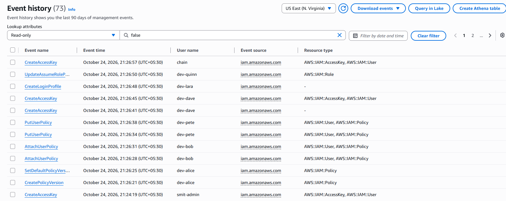

# ShiftGuard


**Finds IAM privilege-escalation paths in Terraform plans, and shows how to catch each one in CloudTrail.**

In simple words: you give ShiftGuard a Terraform plan for AWS. It shows which users or roles could quietly turn themselves into admin, step by step. For each step it points to a Sigma detection rule, so you can also spot the attack in your logs.

- Works on the plan only. Nothing is applied and no AWS account is needed.
- 13 escalation techniques and 10 Sigma rules, mapped to MITRE ATT&CK.
- Fails a pull request when a change would create a path to admin.
- Six of the IAM rules were tested on real events from a test AWS account.

> This is a learning and portfolio project by a cybersecurity student. It is **not** a replacement for [PMapper](https://github.com/nccgroup/PMapper), [Checkov](https://www.checkov.io/) or a real cloud security review. Read "Limits" below before trusting a result.

## Screenshots

**Real CloudTrail events used to test the rules**



## Why it exists

Tools like Checkov are very good at checking each Terraform resource against many rules, and ShiftGuard does not try to replace them. ShiftGuard looks at one narrow thing: IAM permissions across resources. A user can assume a role, and that role can create keys for an admin. Each policy looks small on its own, but together they are a path to admin. ShiftGuard follows that chain and, for each step, points to a way to detect it in CloudTrail.

It works on the **plan**, before anything is applied, so a pull request can fail the build when it introduces a path to admin. Use it next to your normal scanners, not instead of them.

## Quick demo

```
python -m shiftguard.cli terraform/lab-vulnerable/plan.json
```


Options:

| Option | What it does |
|---|---|
| `--json out.json` | write the findings as JSON |
| `--graph out.md` | write the full IAM graph as a Mermaid diagram |
| `--paths out.md` | write only the escalation paths as a Mermaid diagram |
| `--navigator layer.json` | write an ATT&CK Navigator layer showing detection coverage |

To make a plan from your own Terraform (offline, nothing is applied):


Do not commit plans from real accounts. Plan JSON can contain sensitive values.

## What it finds

13 escalation techniques. 9 have a Sigma rule, 4 do not (and say so in the output).

| Technique | ATT&CK | Sigma rule |
|---|---|---|
| iam:CreatePolicyVersion | T1098.003 | yes |
| iam:SetDefaultPolicyVersion | T1098.003 | yes |
| iam:AttachUserPolicy, iam:AttachRolePolicy | T1098.003 | yes |
| iam:PutUserPolicy, iam:PutRolePolicy | T1098.003 | yes |
| iam:UpdateAssumeRolePolicy | T1098.003 | yes |
| iam:CreateAccessKey (for another user) | T1098.001 | yes |
| iam:CreateLoginProfile (for another user) | T1098.001 | yes |
| iam:AddUserToGroup | T1098.003 | no (TODO) |
| sts:AssumeRole into a stronger role | T1548.005 | no (too noisy alone) |
| iam:PassRole + ec2:RunInstances | T1548.005 | no (see limits) |
| iam:PassRole + lambda:CreateFunction | T1548.005 | no (see limits) |

It also ships 3 general rules: CloudTrail logging stopped or changed (T1685.002), console login without MFA (T1078.004) and root account usage (T1078.004). In total there are 10 Sigma rules in `detections/sigma/`.

The ATT&CK IDs follow v20. Note that T1562.008 was revoked and replaced by T1685.002, and the Defense Evasion tactic was split into Stealth and Defense Impairment. Older Sigma rules online still use the old tags.

## Detections

Each rule has malicious and benign CloudTrail test events in `tests/fixtures/cloudtrail/`. The tests check that the malicious events fire the rule and that no benign event fires any rule. The rules also convert with pySigma to Splunk and Elasticsearch ES|QL (all 10 each). Two rules use `fieldref` (comparing two fields) and cannot convert to Lucene, which is documented in [docs/detection-coverage.md](docs/detection-coverage.md).

There is also a small matcher so the rules can run on a JSON file of CloudTrail events without any SIEM:


## ShiftGuard and Checkov

The two tools do different jobs, and I ran both on the same labs. Measured by `python -m benchmark.compare`, full output in [docs/benchmark.md](docs/benchmark.md). Checkov 3.3.30, default checks only.

| Lab | ShiftGuard | Checkov escalation checks |
|---|---|---|
| lab-vulnerable (5 single-step paths) | 5 of 9 principals reach admin | flags all 5 |
| lab-safe (same people, fixed) | 0 | 0 escalation failures, 18 hygiene failures |
| lab-chain (2-step chain) | 2 of 3 reach admin | 0, both policies pass on their own |

What I saw:

- Checkov's `CKV_AWS_286` and `CKV_AWS_289` caught the single risky policies and stayed quiet on the fixed versions. That is strong.
- Checkov checks one resource at a time. In the two-step chain, each policy passed its checks on its own. ShiftGuard's graph follows the chain across resources.
- I built the chain lab myself to test that exact case, so it shows the difference can exist, not that it is common.
- The link between a Checkov finding and a principal is made by resource name, which is a rough guess.
- Checkov covers many other areas that ShiftGuard does not (encryption, logging, networking), and it supports custom checks that I did not try. Use both.

## CI

`.github/workflows/security.yml` runs on every push and pull request: tests on Python 3.11 and 3.14, `sigma check`, ShiftGuard on both labs (the safe plan must pass, the vulnerable plan must fail, otherwise the analyzer is broken), Checkov in soft-fail mode for comparison, and Gitleaks on the full history. `demo-vulnerable.yml` is a manual workflow that fails on purpose to show what a blocked pull request looks like.

## Project layout


Run the tests with `python -m pytest`. The optional pySigma tests need `pip install -r requirements-sigma.txt`.


## Verified on real events

The IAM Sigma rules were run against real CloudTrail events from a test AWS account (Free plan, IAM only). Six rules and the two-step chain fired on the real attack events, and the benign calls stayed quiet. Details, findings and limits are in [docs/live-validation.md](docs/live-validation.md). A cleaned copy of the events is in `tests/fixtures/cloudtrail_real/`.

## Safety

Terraform is only planned, never applied, and the labs use fake credentials with provider validation skipped. No AWS account is needed. Only use ShiftGuard on accounts you own or are authorized to test, and never commit real keys or real plans. Gitleaks runs on every push.

